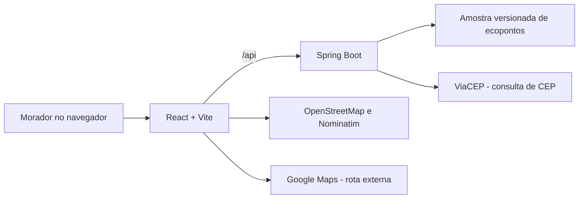
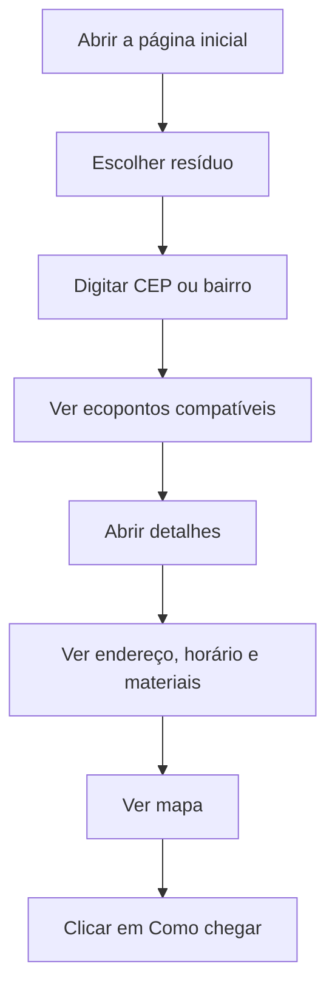

# Arquitetura do EcoDescarte

O sistema é dividido em duas partes. A parte visual é o **frontend**: ela mostra botões, formulários e mapas no navegador. A parte de dados é o **backend**: ela entrega as informações para essa tela por meio de uma API, isto é, um endereço que um programa consulta para receber dados.

## Partes principais

- `frontend/`: página inicial, resultados, detalhes e orientações. Em desenvolvimento, o Vite encaminha chamadas `/api` ao backend.
- `backend/`: rotas REST, filtros e tratamento de erro. A lista fica em código para manter o projeto simples e fácil de demonstrar.
- `docs/`: provas de requisitos, dados, testes e guias.

## Caminho da pessoa usuária

## Endpoints

| Endereço | Finalidade |
|---|---|
| `GET /api/health` | confirma que a API está ligada |
| `GET /api/categories` | devolve as categorias do formulário |
| `GET /api/ecopoints` | lista a amostra, com filtros `category`, `district` e `search` |
| `GET /api/ecopoints/{id}` | abre um local específico |
| `GET /api/waste-guides` | devolve orientações de preparo e destino |
| `GET /api/location/cep/{cep}` | consulta o ViaCEP com CEP higienizado |

No pacote de produção, a interface compilada é servida pelo próprio Spring Boot. Assim há um único endereço público e não há segredo armazenado no frontend.
